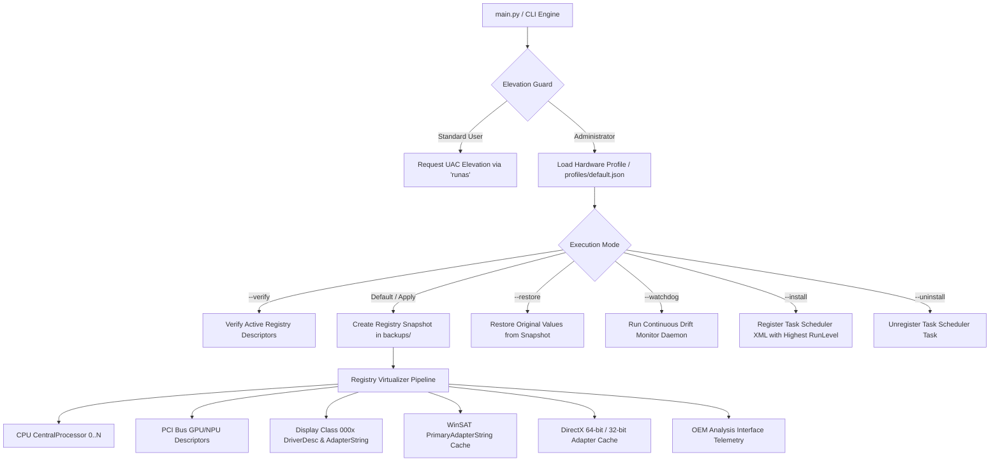

# SpoofHW - Hardware Specification Emulation & Registry Virtualization Suite

[](https://microsoft.com)
[]()
[]()
[]()

## 1. Architectural Overview

**SpoofHW** is a high-performance hardware specification emulation and registry virtualization suite engineered for Windows 10 and Windows 11. It provides deterministic, zero-external-dependency hardware descriptor virtualization across the CPU, GPU, NPU, DirectX runtime cache, WinSAT rating system, and OEM telemetry layers.

The codebase is written in pure modular Python using native standard libraries (`winreg`, `ctypes`, `subprocess`, `argparse`, `json`) with direct support for WOW64 64-bit and 32-bit registry hive redirection bypass.



---

## 2. Project Directory Structure

```
W11 SpoofHW Ultra x9 388H/
├── profiles/
│   ├── default.json                  # Default hardware profile (Intel Ultra X9 388H + Arc B390)
│   └── presets/
│       └── amd_ryzen_ai_hx370.json   # Preset profile for AMD Ryzen AI 9 HX 370
├── backups/                          # Auto-generated registry snapshots for full rollback
├── logs/                             # System execution and diagnostic logs
├── spoofhw/                          # Modular Python engine
│   ├── __init__.py                   # Package initializers and exports
│   ├── config.py                     # Profile dataclasses, loading & validation
│   ├── elevation.py                  # UAC admin check and ShellExecute elevation guard
│   ├── logger.py                     # Colorized console logger & rotating file logging
│   ├── virtualizer.py                # Core virtualization engine (CPU, PCI, Display, WinSAT, DirectX, OEM)
│   ├── snapshot.py                   # Backup, snapshot, and restore subsystem
│   ├── scheduler.py                  # Windows Task Scheduler XML generator & manager
│   ├── watchdog.py                   # Continuous monitoring daemon to prevent OS reset
│   └── cli.py                        # Command-line interface & interactive menu
├── main.py                           # Python application entry point
├── run.bat                           # Administrator launcher script (Python runtime)
├── build_exe.bat                     # Standalone PyInstaller build script (creates run.exe)
├── clean.bat                         # Workspace housekeeping & cleanup script
└── README.md                         # Technical documentation
```

---

## 3. Key Upgrades & Stability Features

### 3.1 Dual-View 64-Bit / 32-Bit Registry Virtualization
Avoids WOW64 redirection glitches by explicitly querying and writing to both `KEY_WOW64_64KEY` and `KEY_WOW64_32KEY` views using Python's native `winreg`.

### 3.2 Automated Registry Snapshot & Rollback (`--restore`)
Before modifying any registry key, SpoofHW automatically creates a timestamped JSON snapshot under `backups/backup_<timestamp>.json`. If you ever need to restore the machine to its authentic hardware state, simply run:
```cmd
python main.py --restore
```

### 3.3 Continuous Watchdog Daemon (`--watchdog`)
Certain Windows updates, display driver updates, or system sleep/wake cycles may reset `CentralProcessor\ProcessorNameString` back to the hardware default. The watchdog daemon periodically polls the active values and quietly re-applies the emulation profile without user intervention.
```cmd
python main.py --watchdog --interval 30
```

### 3.4 Decoupled Hardware Profiles (`profiles/*.json`)
Easily switch hardware profiles or generate custom configurations:
```cmd
python main.py --config profiles/presets/amd_ryzen_ai_hx370.json
```

---

## 4. Command Line Interface (CLI)

```
Usage: python main.py [OPTIONS] (or run.exe [OPTIONS])

Options:
  -s, --silent, -a, --autorun
                        Run silently without interactive prompts (for background tasks/logon)
  -i, --install         Apply hardware profile and register startup Task Scheduler task
  -u, --uninstall       Unregister and remove startup Task Scheduler task
  -v, --verify          Inspect and display active hardware registry values
  -r, --restore [FILE]  Restore registry from backup snapshot file (default: latest)
  -w, --watchdog        Run in continuous background watchdog mode to prevent OS reset
  --interval SECONDS    Watchdog check interval in seconds (default: 30)
  --config, -c PATH     Path to custom JSON configuration profile
  --save-config PATH    Export current hardware profile settings to specified JSON file
  --cpu NAME            Override target CPU name
  --gpu NAME            Override target GPU name
  --npu NAME            Override target NPU name
  -h, --help            Show this help message and exit
```

---

## 5. Deployment & Execution

### Option A: Run via Python
Launch [`run.bat`](run.bat) or execute with Administrator privileges:
```cmd
python main.py
```

### Option B: Build & Deploy Standalone Binary (`run.exe`)
To package the entire Python suite into a single zero-dependency Windows executable:
1. Run [`build_exe.bat`](build_exe.bat).
2. PyInstaller will compile `main.py` and `spoofhw` into a single `run.exe` with embedded UAC Administrator elevation.

---

## 6. Workspace Housekeeping
To purge build artifacts, compiler caches, and temporary files, execute:
```cmd
clean.bat
```
